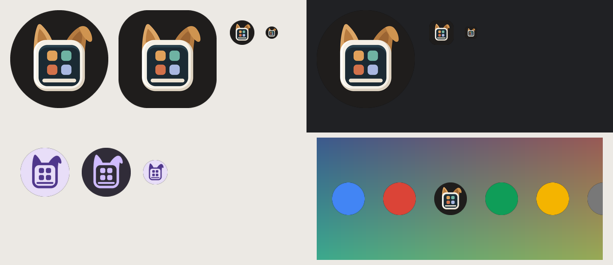

# Chikku app icon: White Coat (Ink-slate)

Selected by the owner on 4 November 2026. It replaces [Screen Ears](../screen-ears/README.md),
which was never committed as the app icon. Original, hand-authored vector artwork drawn from the
owner's photo of Chikku. No image generator was used, and no third-party, launcher or stock artwork
was copied.

## Idea

The icon is a rounded-square phone. Its ivory frame is Chikku's white coat, and his tan ears sit on
top:
- the left ear stands upright
- the right ear flicks outward with its tip folded, as in his photo

The slate screen shows a 2×2 grid of app tiles above a cream dock. The icon reads as "home-screen
app" first. The ears, the ivory-and-tan colouring and the folded ear carry Chikku. There are no
eyes, nose or mouth.

## Palette

The screen colours are deliberately not taken from the photo. A brand colour specialist built them
from the app's own theme:
- The screen is a calm, cool, muted dark, like a phone display that is switched off.
- That lets the warm ivory frame and tan ears stand out as the living part.
- The four tiles are one muted, matched set. The burnt orange is the app's accent, lightened for a
  dark screen.
- Bright primary colours were avoided so the icon does not echo other companies' logos.

| Role | Hex |
|---|---|
| Background | `#1F1D1C` (`@color/chikku_icon_background`, also used for the splash icon and About) |
| Frame, Chikku's white coat | `#FFFDF8` lit, `#F5F0E6` body, `#DDD2C0` shade |
| Ears, tan | `#DCA666`, `#CF9450`, `#B87C40`, `#B57B40`, `#9C6533` |
| Screen lip / screen | `#28404C` / `#1B2A33` |
| Tiles (top-left, top-right, bottom-left, bottom-right) | amber `#E0A15A`, sea-green `#6FB3A3`, burnt orange `#D2714A`, periwinkle `#A9B7E0` |
| Dock | `#EDE4D3` |

Contrast of each tile against the `#1B2A33` screen:

| Element | Contrast |
|---|---|
| Amber | 6.6:1 |
| Sea-green | 6.1:1 |
| Burnt orange | 4.4:1 |
| Periwinkle | 7.4:1 |
| Dock | 11.7:1 |

Two of the earlier photo-based tiles fell below 3:1 on the indigo screen.

## How it was chosen: blind tests

This continues the harness from [Screen Ears](../screen-ears/README.md#why-it-changed-from-blaze-house-blind-tests),
with the same rules:
- five fresh, simulated testers per round, with no project context
- pass: 5/5 top guesses are a launcher, and at least 3/5 describe a dog
- every pass is confirmed by a second fresh round

[blind-test/survey-log.md](blind-test/survey-log.md) records rounds r12–r29. Raw answers are in
`blind-test/answers/` and candidates in `blind-test/candidates/`. The harness scripts are copied in
`blind-test/`.

| Step | Rounds | Finding |
|---|---|---|
| Aesthetic polish of the tall phone | r12–r14 | The polished tall version P2 passed once (5/5, 5/5). |
| Owner asked for a rounded square, kept tan | r16–r19 | 1–2/5 launcher. A tan square reads as the dog's head. |
| Colour on the square | r20–r24 | An ivory frame (his white coat) fixed it. K4 got 5/5 and 5/5. |
| Brand palettes on K4, not photo colours | r25–r29 | A Espresso 4/5. **B Ink-slate 5/5 and 5/5, dog 5/5 both.** C Ember 5/5 and 5/5, dog 5/5 and 4/5. |

The comparison sheets are [palette-compare.png](palette-compare.png) for A, B and C, and
[colour-compare.png](colour-compare.png) for K1–K4. The rejected sources are in `iterations/`.
The brand specialist recommended B, because its cool slate separates most cleanly from the warm dog
at small sizes. The owner chose B.

**Limits.**
- The testers are simulated personas, not people. The results point a direction; they don't prove
  anything.
- Testers' dog mentions were often "dog or fox".
- Check with a few real people before release.

## Files and packaging

- [master.svg](master.svg): the background plus a 15-path foreground on the 108-unit adaptive
  canvas.
  - Runtime: `app/src/main/res/drawable/ic_launcher_foreground.xml`, with the same flattened
    coordinates, solid fills and no group transform.
  - The furthest coordinate, including Bézier control points, is 31.3 units from the centre. That
    is inside the 33-unit safe circle.
- [monochrome.svg](monochrome.svg): ears, frame with the screen cut out, tiles and dock, as one
  colour.
  - Runtime: `ic_launcher_monochrome.xml`, which Android 13+ tints.
- [play-512.png](play-512.png): a full-square, opaque, 32-bit RGBA PNG with embedded sRGB. It is the
  central 72dp area at 512px. It is a source export, not a published store asset.
- [review.png](review.png): previews rendered from the SVGs:
  - circle and squircle masks
  - 48px and 24px, on light and dark
  - themed icons in Material light and dark
  - on a busy wallpaper next to dummy icons

The manifest, adaptive-icon XML and splash references are unchanged. Only the background colour
value changed, from `#252626` to `#1F1D1C`.

## Verification

- `assembleDebug` and `lintDebug` pass.
- The previews were rendered from the SVGs.
- Not yet checked:
  - appearance on a device or emulator
  - OEM masks
  - themed-icon tinting on a real launcher
  - the splash screen
